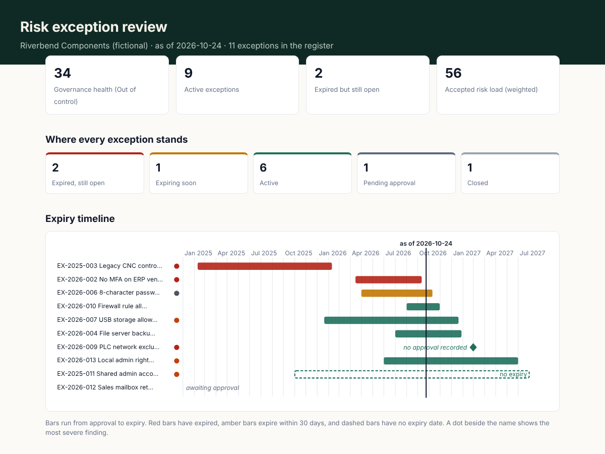

# Risk Exception Tracker

[](https://github.com/Edward-Owusu/risk-exception-tracker/actions/workflows/tests.yml)
[](LICENSE)
[](https://risk-exception-tracker.streamlit.app)
[](https://doi.org/10.5281/zenodo.23615549)

An open-source register and checker for **security policy exceptions and risk acceptances**. It finds the exceptions that are no longer governed: expired but still in use, approved by someone without the authority, owned by someone who has left, missing a compensating control, or renewed again and again with no plan to fix the underlying problem.

It is built for small and mid-sized organizations, such as manufacturers, distributors, clinics, and suppliers, that grant exceptions every year but track them in emails and forgotten spreadsheets.



## Why this matters

Every security program makes exceptions. A machine controller that only runs an old operating system, a vendor that can't support MFA, a business process that conflicts with a standard: accepting these risks is a normal and legitimate management decision.

The trouble is what happens afterwards. Exceptions are rarely reviewed once granted. They expire while the system is still in use, the manager who accepted the risk leaves, and the compensating control that made the risk acceptable stops working without anyone noticing. Over time, a list of carefully approved exceptions becomes a list of unmanaged risks that no one remembers accepting. These gaps are a routine audit finding, and in an incident they are often where the attacker got in.

The NIST Cybersecurity Framework 2.0 names this outcome directly in **ID.RA-07: "Changes and exceptions are managed, assessed for risk impact, recorded, and tracked."** Large enterprises manage it with commercial GRC platforms. This tool gives smaller organizations the same discipline for free.

## What it does

- Runs **13 governance checks** on every active exception, mapped to **NIST SP 800-53 Rev. 5** (RA-7, PM-9, CA-5, CA-7, CM-6, AC-5), **ISO/IEC 27001:2022** (6.1.3, 9.1, A.5.3) and **NIST CSF 2.0** (ID.RA-06, ID.RA-07, GV.RM-04, GV.RR-02).
- Checks **approver authority** against a risk-level approval matrix, using an optional people roster or the approver's job title.
- Finds exceptions whose **owner or approver has left**, and **self-approved** exceptions.
- Calculates a **governance health score** weighted by risk level, and the organization's total **accepted risk load**.
- Places every exception on a **lifecycle board**: expired but still open, expiring soon, active, pending approval, closed.
- Draws an **expiry timeline** from approval to expiry for every exception.
- Lets you **edit the register in the browser**, add new exceptions, re-check, and download the updated register.
- Generates a **risk acceptance memo** for any exception, ready for signature, listing any governance issues to fix first.
- Lets each organization set its own limits: maximum approval period by risk level, review windows, renewal limit, and who may approve what.
- Produces reports in **HTML, Markdown, CSV, and JSON**, with a command-line tool for scheduled runs.
- Has **no third-party dependencies** in its core engine.

## A different kind of dashboard

The other tools in this series assess a configuration once and report. This one is built to be used week to week, so its interface is organized around the register itself:

| View | What it's for |
|---|---|
| **Overview** | Health gauge, key numbers, who holds the accepted risk, and a filterable list of what needs fixing |
| **Lifecycle board** | Every exception as a card in its lane, like a task board |
| **Expiry timeline** | When each exception was approved and when it runs out, and what's coming up in the next 90 days |
| **Edit register** | Add, change or delete exceptions in a table and re-check straight away |
| **Acceptance memo** | A one-page memo for signature, built from the register |

## Quick start

Requires Python 3.10 or later.

```bash
git clone https://github.com/Edward-Owusu/risk-exception-tracker.git
cd risk-exception-tracker
pip install -e .

# Check the sample manufacturer's register as of 24 October 2026
risk-exceptions samples/riverbend_components_exceptions.csv \
  --roster samples/riverbend_components_people.csv --as-of 2026-10-24 --format html md --out reports
```

Example output:

```
Riverbend Components | as of 2026-10-24 | 9 active of 11 exceptions
Governance health: 34/100 (Out of control) | Expired but open: 2 | Expiring soon: 1 | Findings: 3 critical, 8 high, 9 medium, 1 low
  [CRITICAL] EX-2025-003 RE-02 Expired exception still in use
  [CRITICAL] EX-2026-002 RE-02 Expired exception still in use
  [CRITICAL] EX-2026-009 RE-01 Exception in use without a recorded approval
  ...
```

Pre-generated reports are in [docs/example-reports](docs/example-reports).

### Dashboard

```bash
pip install -r requirements.txt
streamlit run app/streamlit_app.py
```

Or try the hosted version at https://risk-exception-tracker.streamlit.app.

### Risk acceptance memo

```bash
risk-exceptions register.csv --memo EX-2026-004
```

### Use in automation

`--fail-on <severity>` exits with code 2 when a finding at or above that severity exists, so a scheduled run can alert the security team when an exception lapses.

## Checking your own register

1. Download `samples/exceptions_template.csv` (and optionally `samples/people_template.csv`).
2. Fill it in from wherever your exceptions live today: a spreadsheet, a ticketing system, or approval emails. The [data reference](docs/data-reference.md) explains every column.
3. Load it in the dashboard under **My own register**, or run the command-line tool.
4. Work through the findings with each risk owner, and keep the register up to date in the **Edit register** view.

## Checks

| Rule | Finding | Severity |
|---|---|---|
| RE-01 | Exception in use without a recorded approval | Critical |
| RE-02 | Expired exception still in use | High (critical for high or critical risk) |
| RE-03 | No expiry date | High |
| RE-04 | Approved for longer than policy allows | Medium |
| RE-05 | Approver lacks authority for this risk level | High |
| RE-06 | Approved by the person who requested it | High |
| RE-07 | No current risk owner | High |
| RE-08 | Approver has left the organization | Medium |
| RE-09 | No compensating control for a high or critical risk | High |
| RE-10 | Compensating control not verified recently | Medium |
| RE-11 | No remediation plan, or remediation date passed | Medium |
| RE-12 | Renewed too many times | Medium |
| RE-13 | Expires soon | Low |

See the [methodology](docs/methodology.md) for how each check and the health score work.

## Project structure

```
src/risk_exceptions/
  data/rules.json      the 13 checks, fixes and framework mappings
  data/model.json      weights, limits and the approval matrix
  engine.py            parsing, checks, lanes and scoring
  reporting.py         HTML, Markdown, CSV, JSON, timeline and memos
  table.py             converts the register to and from the dashboard's editable table
  cli.py               command-line interface
app/streamlit_app.py   interactive dashboard
samples/               two fictional organizations and blank templates
tests/                 unit tests
docs/                  methodology, data reference, example reports
```

## Roadmap

- Import exceptions directly from Jira and ServiceNow request types.
- Email reminders to risk owners before an exception expires.
- Link each exception to the findings in the other tools in this series, so a failed control can become a tracked exception.

## Privacy

The command-line tool runs entirely on your own computer. The hosted dashboard runs on Streamlit Community Cloud: data you upload or type is processed in memory for your session and not saved by this app. For sensitive registers, run the dashboard locally (`streamlit run app/streamlit_app.py`).

## Data and limitations

All sample data is synthetic and does not describe any real organization. The tool checks how exceptions are governed; it does not judge whether accepting each risk was the right decision, and its results are only as complete as the register supplied. It supports, and does not replace, the judgment of a qualified auditor.

## References

- NIST Cybersecurity Framework (CSF) 2.0: https://nvlpubs.nist.gov/nistpubs/CSWP/NIST.CSWP.29.pdf
- NIST SP 800-53 Rev. 5, *Security and Privacy Controls for Information Systems and Organizations*: https://csrc.nist.gov/pubs/sp/800/53/r5/upd1/final
- ISO/IEC 27001:2022, *Information security management systems: Requirements*: https://www.iso.org/standard/27001

## Author

**Edward Owusu, CISA**, GRC Analyst and IT Auditor.

Part of a series of open-source GRC tools for small and mid-sized organizations: https://github.com/Edward-Owusu

## Citation

If you use this tool in research or professional work, please cite it using the metadata in [CITATION.cff](CITATION.cff).

## License

[MIT](LICENSE)
